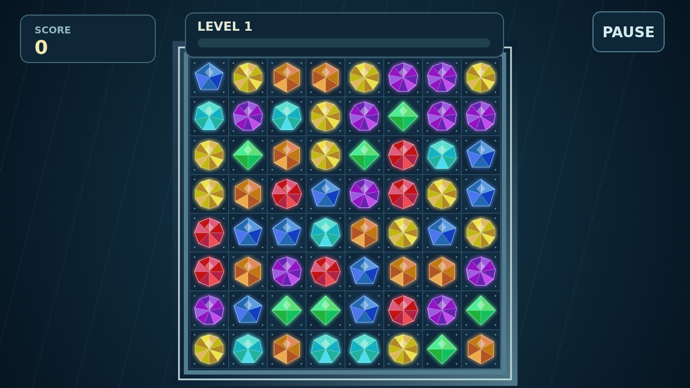

# Facet

A board of seven cut stones waits for one good swap. Carry a gem onto its neighbor and let go: three of a kind shatter, and the stones above tumble down to fill the light they leave behind.

Each clear presses on the stones still standing. Cracks deepen until a gem is flawed; then the next clear touching it sets it off for double points. A small match at the edge of a worn patch can open a much longer chain, with every step worth more than the last.

Long lines leave tools for the next move. Four stones make a brilliant that reaches around itself. Five make a prism that sweeps away a chosen kind when swapped. Cross two lines to leave a star that can take a whole row and column. Read the pressure, make the cut, and climb through the levels before the board runs out of moves.

